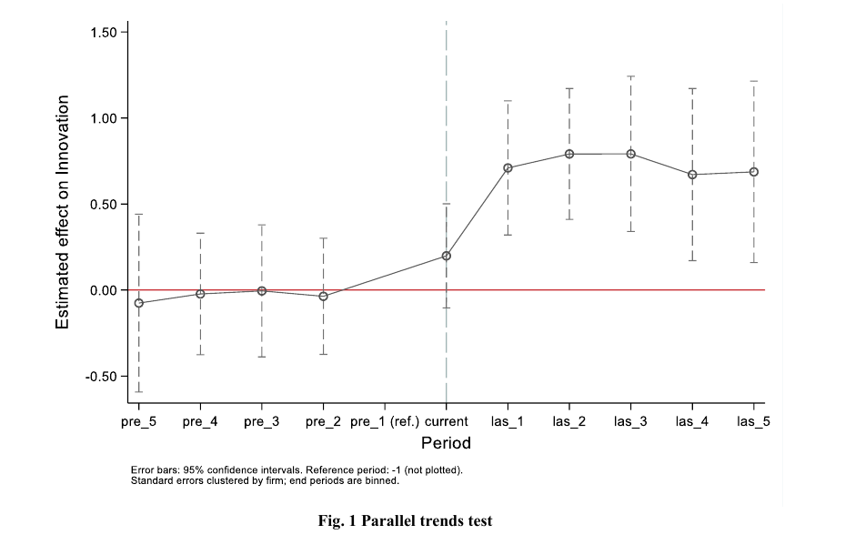

# 吉大正元披露低空业务收入占比较低；黄石政务低空采购延期至11月4日；青岛无人机双赛开幕｜低空日报 2026.10.19

**今日总结**：吉大正元公告称，低空相关业务收入占比较低，尚未形成规模化收入；北京驭风飞行的“云哨”浮空器完成分时段首飞试验，极端雷暴条件下的平台保全仍待验证。青岛中韩无人机邀请赛与省级航模锦标赛开幕，黄石政务低空采购则调整技术要求并延后响应截止。学术方面，一篇预印本讨论政府引导基金与产业资本共同参股基金对企业创新的影响，研究结论受上市公司样本和专利口径限制。

## 一、低空企业动态

### 1. 吉大正元：低空相关业务尚未形成规模化收入

吉大正元在股票交易异常波动公告中表示，公司参与制定“星—机—地”协同安全解决方案，配载其安全组件的相关试验卫星已于2026年4月发射，但相关业务收入占比较低，尚未形成规模化收入，不会对当前经营业绩产生较大影响。本次披露的是业务进展及经营口径说明，并非新增订单或交付公告。

来源：[长春吉大正元信息技术股份有限公司董事会，公告2026-040原文PDF（新浪财经承载）](https://file.finance.sina.com.cn/211.154.219.97:9494/MRGG/CNSESZ_STOCK/2026/2026-10/2026-10-19/12647506.PDF)｜2026-10-19（公告日期及落款日期）

### 2. “云哨M1000-CNS”在自贡完成首飞系列试验，组网及极端雷暴验证仍待开展

10月13—16日，北京驭风飞行研发的“云哨M1000-CNS”在四川自贡荣县分时段完成首飞系列试验，涉及总装、浮力转移、锚泊系留和低空悬驻等流程。据研制方介绍，试验采集30余项既定科目数据，后续还将验证多台组网、天地协同及极端雷暴条件下的平台保全；不能将设计驻空年限视为已完成的运行实绩。

来源：[经济参考网，邹易](https://www.jjckb.cn/20261016/4d9100bf975e40e688d3f0a88cd9b0f2/c.html)；[新华网现场图文报道](https://www.xinhuanet.com/photo/20261016/1cc186e393264e5680f17beee049f65d/c.html)｜2026-10-16（新华网图文发布于21:19:16；试验10月13—16日）

## 二、低空应用动态

### 1. 青岛中韩无人机邀请赛与省级航模锦标赛开幕，青铁低空集团协办

青岛日报社／观海新闻10月18日报道，中韩无人机邀请赛暨山东省航空航天模型（含无人机）锦标赛于17日在青岛开幕，赛期至19日，汇聚800余名选手，其中韩国青少年40余名。赛事由山东省航空运动协会等联合主办，青岛地空产融发展有限公司承办，青岛青铁低空经济发展集团有限公司协办，包含无人机竞速、足球等项目。

来源：[青岛日报社／观海新闻，记者周建亮，青岛新闻网刊载](https://news.qingdaonews.com/wap/2026-10/18/content_23761747.htm)｜2026-10-18 18:03（开幕日期10月17日）

## 三、低空学术

### 1. 预印本：联合基金投资有助于企业创新，样本限于低空相关上市公司

Lei Yi、Xinyi Liao的预印本估计，政府引导基金与产业资本共同参股的子基金投资，有助于提高低空相关上市企业的发明专利申请量。研究以2006—2024年A股企业为样本，用多期双重差分比较受投企业与对照组的创新变化，并发现风险收益安排和产业关联与效应强弱相关。研究提示资金组织方式的作用，但未直接观察资源转移，也未完全排除投资选择影响；专利涵盖企业全部业务，结论不宜直接外推至未上市初创企业。

*图：作者原稿图1，横轴为相对联合基金投资年份，误差线为95%置信区间。作者：Lei Yi、Xinyi Liao；来源：[Research Square预印本PDF，第15页](https://www.researchsquare.com/article/rs-11055115/latest.pdf#page=15)，[CC BY 4.0](https://creativecommons.org/licenses/by/4.0/)。仅裁切版面，未改图内内容；图中估计不等于经营收益或投资回报。*

来源：[Research Square原始发布页，v1](https://www.researchsquare.com/article/rs-11055115/v1)；[论文PDF](https://www.researchsquare.com/article/rs-11055115/latest.pdf)｜2026-10-13（预印本；本条依据原稿研究设计、结果及局限部分）  
题名：Policy-industrial capital collaboration and firm innovation in the low-altitude economy: Evidence from government-guided funds’ equity participation in China  
DOI：10.21203/rs.3.rs-11055115/v1

## 四、行业机会

### 1. 山东信息职业技术学院采购测绘实训设备，整包预算73万元

山东信息职业技术学院10月17日发布测绘实训室设备招标，包1预算和最高限价均为73万元，含无人机算力盒子2台、小型无人机1台、航测激光雷达1台及移动测量、点云处理设备。文件获取至10月23日，投标截止11月10日09时，均通过山东省政府采购电子交易系统办理，不接受联合体；73万元为整包而非单独无人机预算。

来源：[中国政府采购网，采购人：山东信息职业技术学院；代理：盛和招标代理有限公司](https://www.ccgp.gov.cn/cggg/dfgg/gkzb/202610/t20261017_27513542.htm)｜2026-10-17 23:45  
项目编号：SDGP370000000202602009691；包号：1。文件获取时间及资格条件以原公告和最新采购文件为准。

### 2. 黄石政务低空采购响应截止延至11月4日09时，调整设施及平台对接要求

湖北省成套招标10月16日发布黄石市数据局政务低空购买服务项目更正，响应截止由10月19日09时延至11月4日09时。更正要求投标人承诺在220平方公里先飞区投入不少于30架无人机、30个无人值守全自动固定起降点，并完成相关政务平台对接。这是投标履约要求，不代表设施已建成；公告未说明文件获取期同步延长。

来源：[采购代理机构湖北省成套招标股份有限公司，更正公告原文](https://www.hubeibidding.com/view/53348.html)｜2026-10-16（首次招标公告9月24日）  
采购人：黄石市数据局；项目编号：HBCZ-2604060924-262138。新供应商能否获取文件须向采购人／代理核实。
